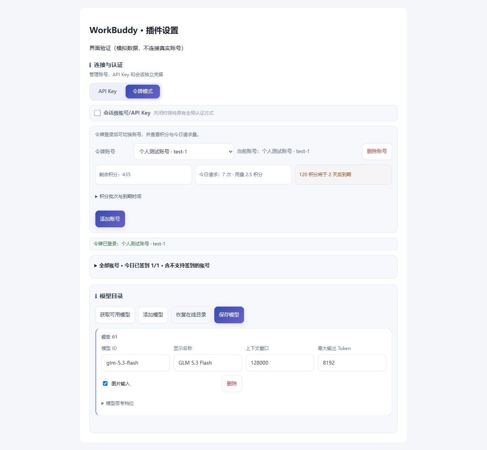
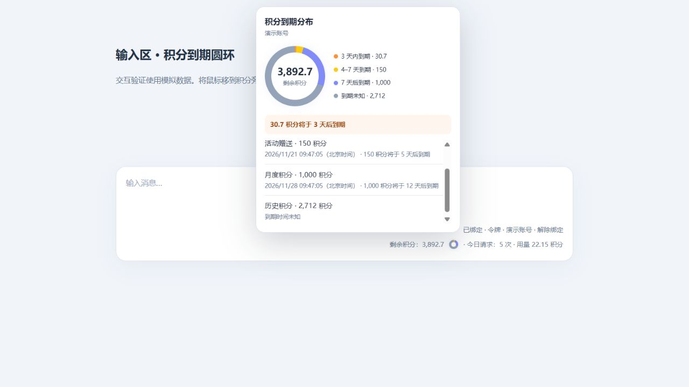
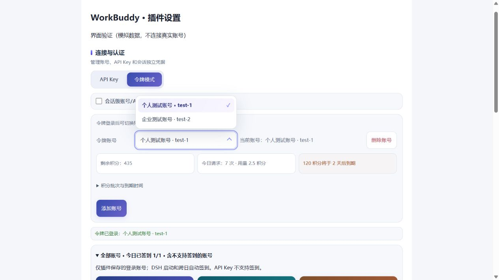

# DSH WorkBuddy Provider

在 DeepSeek Harness（DSH）桌面端和 WebUI 中使用 WorkBuddy 中国区模型，支持 API Key 和账号登录。

> 本插件是第三方适配工具，不属于 WorkBuddy 或 DSH 官方项目。使用前需准备有效账号或 API Key。

## 功能

| 功能 | 说明 |
| --- | --- |
| 两种认证方式 | 支持 API Key、浏览器账号登录，可随时切换 |
| 多凭据管理 | 添加、切换和删除多个 API Key 或登录账号 |
| 会话独立选择 | 可为不同会话分别指定账号或 API Key |
| 模型管理 | 获取可用模型，添加、编辑、删除模型或恢复在线目录 |
| 模型参数 | 按模型配置上下文窗口、最大输出 Token 和思考档位 |
| 账号用量 | 令牌模式下查看剩余积分、今日请求次数和积分用量 |
| 每日自动签到 | DSH 启动及跨日时为插件保存的全部登录账号签到，支持手动重试 |
| 积分到期提醒 | 显示最近到期积分、剩余时间和各批次具体到期日期 |
| 全账号面板 | 集中查看签到结果、获得积分、余额和更新时间，不切换当前会话 |
| 全 DSH 用量统计 | 按服务商和模型查看今日、本周、本月及累计 Token、日周月趋势和生成速度 |
| 多端支持 | 支持桌面、Web 和 Headless 使用方式，兼容 ModLens 包装模型 |

不需要安装本机 WorkBuddy CLI。模型可用范围及用量以当前账号权限和服务返回结果为准。

## 界面预览

以下截图来自界面验证页面，均使用模拟账号与积分数据，不代表实际账号余额。

### 账号管理与模型配置

认证切换、账号管理与模型编辑采用统一卡片样式；签到看板可展开查看全部账号。



### 输入区积分圆环

积分右侧的小圆环支持悬停、聚焦或点击展开，卡片内可查看完整分布和各批次到期明细。



### 下拉框与选项列表

设置页和会话中的下拉框使用统一的箭头、聚焦状态和选项菜单；支持方向键选择、Enter 确认、Esc 关闭。较旧浏览器会保留系统选项菜单。



## 环境要求

- 已安装 DSH，支持已声明兼容的旧版和 `0.2.x` 系列。
- Node.js `>= 22.19.0`。
- 支持 Windows、Linux、macOS。

DSH 升级到新版本系列后，请先确认插件兼容性。

## 安装与更新

### 桌面端

在 **设置 → 插件 → 添加插件** 中安装：

```text
@axiaohungry/dsh-llm-workbuddy
```

也可以在终端执行，更新时使用同一条命令：

```powershell
dsh plugin --profile desktop add @axiaohungry/dsh-llm-workbuddy@latest
```

### Web / Headless

一键安装或更新这两个 Profile：

```powershell
npx --yes @axiaohungry/dsh-llm-workbuddy@latest install
```

仅安装 Web Profile：

```powershell
dsh plugin --profile web add @axiaohungry/dsh-llm-workbuddy@latest
```

**安装或更新后，完整退出并重新启动 DSH。** 只刷新页面不会完成更新。
更新可保留已有模型、账号和 Key 配置。

## 使用方法

### 1. 打开配置

桌面端进入 **设置 → 插件 → WorkBuddy 插件详情**。
WebUI 进入 **设置 → 模型**，添加或编辑 **WorkBuddy 中国区**。
具体入口可能随 DSH 版本略有不同。

### 2. 选择认证方式

**API Key**

1. 选择 `API Key` 模式。
2. 在“新增 API Key”中粘贴 Key，可填写便于识别的名称。
3. 点击“添加并使用”，或从下拉列表中选择已有 Key。

也可选择环境变量 `WORKBUDDY_API_KEY`；兼容已有的 `CODEBUDDY_API_KEY`。
API Key 模式不显示账号令牌积分。

**令牌登录**

1. 选择 `令牌登录`。
2. 点击登录或添加账号，在浏览器中完成登录。
3. 返回 DSH，选择要使用的账号。

支持保存多个账号。删除账号会移除该账号的本地登录凭据。

### 3. 选择模型

点击“获取可用模型”，选择需要的模型，再点击“保存模型”。
可按需修改模型名称、上下文窗口、最大输出 Token 和思考档位。

更换账号或 Key 后，建议重新获取可用模型。手动添加模型时，请确认模型 ID 和账号权限。
“恢复在线目录”会取消手工覆盖的模型列表。

### 4. 可选：为会话单独选择凭据

打开“会话级账号/API Key”开关后，可在新会话或输入框附近选择凭据。

- 未绑定会话首次调用时，使用当前默认选择。
- 已绑定会话继续使用自己的选择，不随全局默认值变化。
- 可单独切换或解除当前会话绑定。
- 关闭开关后使用全局选择；重新开启后恢复已有绑定。

账号模型权限不同时，还需选择该账号可用的模型。

### 5. 每日签到与积分到期

在插件设置中查看“全部账号”面板：

- 自动签到随 DSH 桌面端或 Web 服务运行；不创建独立后台任务。
- DSH 启动后自动检查插件中全部已保存登录账号，运行期间按北京时间跨日检查；关闭期间不运行，下次打开检查当天状态。
- 当天已成功的账号跳过，失败可点击“签到 / 重试”，也可“全部签到”。
- 点击“刷新全部余额”更新各账号积分；展开“积分批次与到期时间”查看数量、具体日期及倒计时。
- 企业账号不支持签到时会显示原因，仍可查看余额；API Key 不支持账号签到。
- 输入区“剩余积分”右侧提供小圆环：悬停、键盘聚焦或点击可查看大圆环和各批次到期明细；支持滚动、Esc 关闭。
- 到期时间以服务端数据为准，未知时间明确标注；“今日已签到”不会推算本次奖励数量。

### 6. 全 DSH 用量统计

在插件详情或“模型 → WorkBuddy 中国区”中展开“用量统计”（默认折叠），可查看整个 DSH 的使用记录，与当前 WorkBuddy 账号选择无关。

- 支持按服务商、模型筛选；同名模型在不同服务商下分别汇总。
- “今日 / 本周 / 本月 / 累计”按北京时间统计；本周从周一开始。点击指标卡可切换下方统计范围。
- 趋势图支持按日、周、月切换，最多展示最近 30 个周期；累计卡与模型表不会因此截断。
- Token 总量使用日志报告的实际用量，包含缓存；缺少用量的响应不会按文本长度猜测。
- 生成速度按有效样本的输出 Token 总和除以流式耗时总和计算，包含思考和工具参数；缺少有效计时则明确显示。
- 首次扫描已有日志可能需要一些时间，后续增量更新；扫描失败、断尾和缺失计量会在面板提示。
- 全程只读本机会话日志，仅缓存统计数字，不上传日志，不依赖原 dashboard 插件。

## 1.5.0 更新

- 集成全 DSH 的服务商、模型、Token 周期与生成速度统计。
- 增加日周月趋势、筛选和只读增量历史扫描。
- 统一字体、控件与分组层级，按弹窗内部宽度适配表单和卡片；模型编辑后在底部保存。
- 趋势柱状图支持悬停或键盘聚焦查看 Token 分项、请求次数及生成速度。

## 1.4.1 更新

- 统一账号、API Key、新会话和已绑定会话的下拉框样式。
- 优化展开列表的圆角、阴影、选中提示、禁用项与键盘交互。
- 保留已有凭据选择和会话绑定逻辑。

## 1.4.0 更新

- 新增全部登录账号的每日自动签到、签到结果和手动重试。
- 新增积分到期倒计时、批次明细和输入区悬停圆环。
- 新增签到进度、余额汇总和近期到期积分看板。
- 统一认证、账号、API Key、会话控件和模型编辑器样式。
- 继续改善客户端调用兼容性，保留限流重置时间提示与手动模型选择。

模型权限、签到资格、积分到期和频率限制以服务端返回为准。

## 常见问题

| 问题 | 处理方法 |
| --- | --- |
| 找不到 WorkBuddy 提供方或设置入口 | 确认安装到正在使用的 Profile，完整重启 DSH 后再查看插件详情或模型设置 |
| 更新后仍是旧版本或旧界面 | 重新执行对应 Profile 的更新命令，完整退出并重新打开 DSH |
| API Key 下拉列表没有新 Key | 在插件自己的“新增 API Key”区域提交，点击“添加并使用” |
| 登录成功但调用使用了其他账号 | 检查是否启用了会话级凭据，并核对当前会话的绑定 |
| 获取模型失败或找不到模型 | 核对当前账号或 Key，重新获取目录；手动添加时检查模型 ID 和账号权限 |
| 返回 `429 / 6004` | 当前模型触及服务端频率限制；按提示等待重置，或手动选择同一账号下的其他可用模型。不会自动切换模型或账号 |
| 返回 `401 / 403` | 检查 Key 是否有效、账号是否过期，以及是否具有目标模型权限；必要时重新登录 |
| 返回 `400 / 11128` | 更新到最新版本并完整重启；仍失败时记录业务码、插件版本和使用的模型后反馈 |
| 返回 `500`、空响应或请求长时间无结果 | 更新并重启，检查网络；使用包装模型时，也检查相应服务状态 |
| 自动签到未完成 | 确保 DSH 正在运行；展开全账号面板查看结果，网络恢复后重试；登录失效时重新登录 |
| 企业账号无法签到 | 上游不支持企业账号签到，不影响模型调用和余额查询 |
| 到期时间未知 | 上游未提供该批次的有效到期时间，刷新余额后再查看 |
| 不显示积分，或显示“暂不可用” | 确认使用令牌模式；积分服务暂时不可用不一定影响模型调用 |
| 思考档位选项与其他模型不同 | 属于正常情况，按该模型显示的可用选项选择 |
| ModLens 模型慢、超时或返回 `429` | 检查 ModLens 视觉引擎的登录、网络和额度；纯文本任务可先切换 WorkBuddy 直连验证 |

查看桌面 Profile 的安装版本：

```powershell
dsh plugin --profile desktop list --depth 0
```

Web 用户将 `desktop` 改为 `web`。ModLens 用户也可运行：

```powershell
modlens doctor --json
```

反馈问题时，请提供插件版本、DSH 版本、模型名称、认证方式和脱敏后的错误信息。
**不要公开 API Key、登录令牌或未经脱敏的完整日志。**

## 卸载

桌面 Profile：

```powershell
dsh plugin --profile desktop remove @axiaohungry/dsh-llm-workbuddy
```

Web / Headless 安装器：

```powershell
npx --yes @axiaohungry/dsh-llm-workbuddy@latest uninstall
```

卸载后重启 DSH。安装器默认保留凭据，便于后续重新安装。

## 第三方说明

用量统计的部分日志读取和流式计时逻辑参考 [weibaohui/dsh-dashboard](https://github.com/weibaohui/dsh-dashboard)，遵循 MIT 许可证，详见 [第三方许可](./THIRD_PARTY_NOTICES.md)。

## License

[MIT](./LICENSE)
